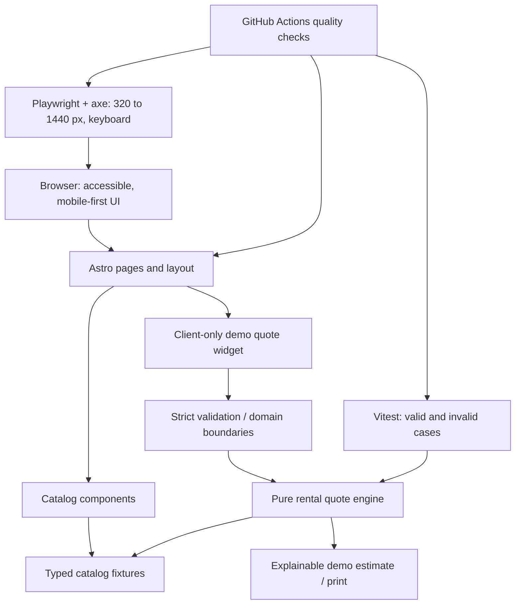

# Architecture decision — Opalubka portfolio demo

**ADR-001 · Proposed / scoped approval for next PR only**
Date: 2026-10-29
Issue: [#2](https://github.com/ruslanudintsev-ai/opalubka/issues/2)
Baseline: `main@28c1fe9fc8d1aa4817a089dff18a00941fdb39e8`
Supporting evidence: [AUDIT_BASELINE.md](./AUDIT_BASELINE.md)

## Context and constraints

The current project is a single `index.html` file with inline styling/scripts and a minimal README, not an operating rental company. Goals: portfolio-quality maintainability, mobile-first user experience, accessible controls, transparent demo price logic and independently reproducible test/CI evidence. **Never turn fictional numbers into implied commercial facts.**

Hard constraints: **no merge, deploy, paid APIs, DNS/secrets/analytics changes, real data collection, or public-profile changes** without separate owner approval. Browser and automated test results must be obtained and attached honestly on the exact candidate SHA, not promised or invented.

## Decision (provisional for P1)

**Recommend Astro + TypeScript strict + a small CSS design-token system**; keep product data in typed local fixtures and quote computation in a pure, separately testable module. Start with **Astro components and framework-free browser TypeScript** for interactive calculator/filter, and upgrade a discrete interactive widget to **React island only if tests and state complexity justify it**.

Reasoning: most page content is static and benefits from simple server/static-rendered HTML, accessible native controls and minimal client-side JavaScript. The calculator is a small reactive island that does not require full SPA hydration. Astro is not a requirement in itself: if migration overhead exceeds demonstrable benefit, retain a **Vite + vanilla TypeScript** implementation instead and document that measurable decision.

**No backend in P1/P2.** Quotes are explicit, locally derived demo data. Form interaction is non-collecting and communicates that nothing is sent. A backend proposal is P3-only with separate authorization.

## Alternatives considered

| Option | Benefits | Costs and risks | Decision |
| --- | --- | --- | --- |
| Leave single HTML + improve JS | No dependencies; straightforward hosting; fastest fix for false claims | Hard to maintain 1,394-line mixed source; logic/test isolation needs extra restructuring | Good immediate P1a hotfix path, not the full portfolio target |
| **Astro + strict TS + CSS tokens** | Static SEO/semantics, composable pages, selective hydration, isolated typed domain | Build/maintenance dependency, migration regression risk, adapter/version upkeep | **Preferred candidate** after P1a |
| Vite + vanilla TypeScript | Light tooling, no UI framework, clean testable modules | Manual template/components or extra tooling; SEO and page organization by convention | **Fallback** if Astro complexity has no value |
| React + Vite for entire page | Mature ecosystem and component testing | Hydrates static marketing content, larger JS baseline; over-engineering for few controls | Reject for now |
| Astro + React island + Tailwind + state manager from day one | Demonstrates broad tooling | Duplicate UI abstractions, churn and code not justified by current feature set | Reject automatic inclusion |
| Cloudflare Workers/D1 or arbitrary API | Future integration demonstration | Data/storage/security/legal cost without a real backend need; possible billing | **Defer P3**, owner approval required |

There are **no present paid-service requirements**. Astro, TypeScript, Vitest, Playwright and open-source tooling are free software, but dependencies entail installation, updates, CI compute and potential platform quotas. No numeric bundle-size, install-time or CI-cost claims are made without measurements.

## Proposed module boundaries



The diagram is a **target design, not a claim of implemented architecture**. No user PII or remote storage path exists in the target flow. Later read-only API, if justified, would require a new ADR and permission.

Possible (not yet committed) layout:

```text
src/
  layouts/BaseLayout.astro
  pages/index.astro
  components/{Header,Catalog,QuoteCalculator,Footer}.astro
  data/equipment.ts
  domain/{rentalQuote,validation}.ts
  styles/tokens.css
tests/{unit,e2e}/
public/assets/             # only owner-created or licensed assets
.github/workflows/quality.yml
docs/{DEMO,ARCHITECTURE,QA_EVIDENCE,PRIVACY_AND_DATA}.md
```

Avoid third-party fonts/images by default: use a system font stack and original minimal SVG/diagrams; any outside media requires source/license evidence. Do not reuse `image.qwenlm.ai` assets without rights verification.

## Product data contract and quote policy (proposal)

Equipment entries are demo fixtures with stable `id`, `category` (three or more meaningful groups), label, specs with measurement units, illustrative availability (if shown, explicitly fictional), `dailyRateRubPerM2` or a carefully defined separate billing unit, source/status (`DEMO_FIXTURE`), and an asset reference with rights metadata. Use TypeScript types; add Zod **only where a real runtime trust boundary or external import exists**, not solely for a dependency badge.

Calculation inputs: known equipment type, finite positive area in m², integer positive number of **30-day billing periods**, explicit caps against abuse/overflow, and an optional publicly explained *demo discount* table. Formula:

```text
days = billingPeriods × 30
subtotalRub = areaM2 × dailyRateRubPerM2PerDay × days
demoTotalRub = roundToRub(subtotalRub × applicableDemoDiscount)
```

**Never** silently coerce empty/negative/nonfinite/fractional period input to valid defaults. Area precision/maximum and discount table are to be defined in P1c with tests, not assumed as real business rules. Show the breakdown, assumptions, rounding, unit meaning, and exclusions (delivery, deposit, VAT and accessories unless explicitly modeled). Formulas and displayed defaults must agree with and without JS or show an honest “run calculator” placeholder. Data is fictional; not an offer, invoice, lead submission or actual market price.

**Negative scenarios required:** blank, whitespace, zero, negative and nonnumeric fields; huge and fractional numbers; unknown type; malformed period; mismatched catalog ID; switching type; 1/2/3/6/7 billing periods; deterministic rounding; no network writes; quote print/export carries DEMO watermark.

## Progressive PR plan and quality gates

| PR | Scope (reviewable slice) | Minimum evidence / done criterion |
| --- | --- | --- |
| **P0 / this PR** | Inventory, risk matrix, decision alternatives, costs, Mermaid, gaps | Correct baseline and actual changed files; verify documentation in GitHub; **no claim of runtime PASS** |
| **P1a** | Disclaimers and copy, remove misleading testimonial/contacts, no-op demo form and placeholders; critical a11y labels | Manual review, static scans and if possible Playwright smoke, no fake success |
| **P1b** | Astro/TS project bootstrap, catalog fixtures/component decomposition, original/licensed images | `npm ci`, typecheck, build, source and asset license inventory; no unsolicited backend |
| **P1c** | Quote engine, validation, catalog filtering, print/export demo estimate | Vitest branch/boundary cases, E2E input states, precise formula cross-check |
| **P2a** | GitHub Actions reproducible checks, lint/format, browser + axe tests | CI links and artifacts per exact commit, no invented PASS if tools unavailable |
| **P2b** | RU/EN README, architecture + privacy + QA documents, genuine browser screenshots | Actual screenshots with SHA, viewport, environment; independent review |
| **P3 (optional)** | Written design for read-only fixture API / preview | **Separate GO** before domains, hosting, billing, data or public deployment |

Reduce the number of PRs if a slice is demonstrably too small, but do **not** combine unrelated architectural rewrites, business claims and infrastructure. Every PR must target `main` and remain **Draft** until independent reviewer feedback and explicit owner decision. Avoid competing changes to already-open branches; reconcile if one appears.

## Quality workflow / reproducibility design

1. A clean checkout must define Node LTS, locked dependencies and exact `npm ci` installation. Scripts proposed: `npm run lint`, `npm run format:check`, `npm run typecheck`, `npm test`, `npm run build`, `npm run test:e2e`. Document which ones are actually implemented with versions.
2. Unit tests cover valid examples and invalid boundaries, no unstated fixtures; no downstream API mocks that imply a real submitted order.
3. Playwright covers 320, 360, 390, 768 and 1440 px, nav/menu/focus/modal, filtering, all demo calculator cases, console errors and network write prohibition; verify Chromium, Firefox and WebKit *only where runners support them*. Axe is complementary to manual accessible-name, Tab, Escape, focus and screen-reader inspection.
4. Asset/link check includes no dead `#`, no broken local assets and no unidentified third-party requests; license inventory is manual/evidence-based.
5. CI to run on PR against `main`; use normal non-privileged permissions, no secrets and no deployment steps. Record workflow run URL, status, attempts, exact head SHA, versions, failed tests and artifact expiry.
6. Lighthouse/Core Web Vitals to be measured on actually served candidate in a controlled environment, not inferred from source. Define performance budget after first measured baseline.
7. Independent ChatGPT reviewer comments on **exact candidate SHA** with findings (including unresolved gaps), author fixes in same Draft branch, then re-checks latest SHA.

**Security/privacy:** no analytics by default; no collection of real PII; no paid API or cloud credentials; no outgoing form submissions; no real business identity; use least-privilege GitHub Actions and avoid logs containing contact fields. Browser test data must be obviously synthetic and must never contact real recipients.

## Open decisions and explicit non-goals

- Confirm precise demo pricing and category definitions, including whether area represents surface or pieces; decide area input range/precision using documented fictional rules.
- License status of old remote imagery is unknown; plan replacement without copying it.
- No proof of deployed domain, performance, accessibility, business legitimacy or historic compliance; verify separately if ever relevant.
- No authentication, customer database, payment, request CRM, live inventory, AI chat widget, automatic deploy, DNS, cloud project or public profile modification in authorized scope.
- Owner approval is needed for production release, external-hosting change, API/billing, analytics, credentials, real PII collection and PR merge.

**Review status:** proposal intentionally leaves technology choice reversible until P1b and evidence-based. This ADR documents an engineering direction, **not completed implementation**.
