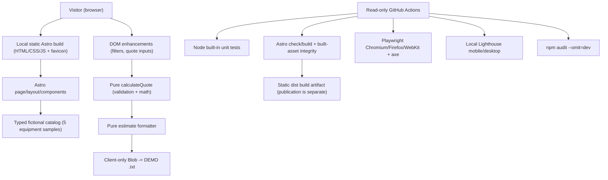

# Architecture — Opalubka / LAB portfolio demo

**Implementation location:** `modern/`, developed in [Astro PR #5](https://github.com/ruslanudintsev-ai/opalubka/pull/5) and paired with [integration PR #6](https://github.com/ruslanudintsev-ai/opalubka/pull/6). **Historical baseline:** `main@28c1fe9fc8d1aa4817a089dff18a00941fdb39e8` on 2026-10-29 contained a legacy root `index.html`; PR #6 removes it as an integration change. That historical fact does **not** describe current `main` at all future dates. This document describes implemented architecture, **not** evidence of a published website. Confirm publication from an independently verified live URL and deployed SHA.

## System boundaries



### Component and module map

| Path | Responsibility |
| --- | --- |
| `src/pages/index.astro` / `layouts/BaseLayout.astro` | Static Russian-language page, SEO metadata, semantic landmarks, explicit fictional-demo copy |
| `src/components/EquipmentCard.astro` | Accessible native selection controls and reusable card |
| `src/data/catalog.ts` | TypeScript fixture ID/category/rate contracts; no network inventory |
| `src/data/illustrations.ts` | Five original conceptual, **not engineering**, SVG drawings |
| `src/domain/quote.ts` | Pure input validation: area 0.01–10,000 m² (<=2 decimals), 1–12 whole 30-day periods; synthetic rates and discounts |
| `src/domain/estimate.ts` | Deterministic UTF-8 marked DEMO text estimate, no identifying fields |
| `src/scripts/demo.ts` | Browser filter state, calculator events and Blob download, with no remote writes |
| `src/styles/main.css` | Theme tokens, responsive layout, reduced-motion and print-only estimate |
| `scripts/check-built.mjs` | Fail-closed validation of produced HTML, internal anchors, local assets, visible DEMO and no legacy forms |
| `scripts/check-audit.mjs`, `scripts/check-lighthouse.mjs` | Numeric report integrity and advisory gate; always distinguish simulated lab from field performance |

No React hydration, backend, database, authentication, customer PII or fake order form exists in this candidate. Introducing them without a real user requirement would increase complexity and privacy/security surface.

## Reproducible commands

Requires Node.js 24 and npm. From `modern/`:

```sh
npm ci
npm run check
npm test
npm run build
npm run check:artifact
npx playwright install --with-deps chromium firefox webkit
npm run test:e2e
npm run preview
```

GitHub Actions validates source SHA, type/build/unit/browser/a11y gates, local Lighthouse and npm advisory checks; screenshots and reports are temporary artifacts. Built `dist/` is **the expected static web root**, not `modern/` source files or the repository root. A CI artifact **does not constitute hosting**; a deployment must be confirmed separately at the live URL and exact published SHA.

## Deployment contract and rollback (requires evidence of execution)

Any live hosting, DNS or merging action requires a separate owner decision. After approval, serve only compiled `modern/dist/` as the static web root. Do not serve the **historical legacy root HTML** or uncompiled `modern/src/` as the public site. Before any release, record the current hosting config, publish target, baseline checksum and tested artifact SHA. Recheck live responses from a real URL after deployment. For rollback, restore the recorded previous artifact/config; do not guess at deployment credentials or IP addresses. See [INTEGRATION_AND_RELEASE.md](./INTEGRATION_AND_RELEASE.md).

## Security and claim boundaries

- No user data collection: no contact forms, backend fetches, analytics or cookies in the described source. Third-party hosting may still log access; that is **not verified**.
- Catalog prices are entirely illustrative, not market data or a legal offer.
- The exact point-in-time test result is in GitHub workflow runs; local Lighthouse is not field Core Web Vitals and automated axe is not a full screen-reader acceptance.
- All drawings were created as project-owned source rather than copied from vendors. Other open-source packages retain upstream licenses; the owner approved MIT for project-controlled source/docs/original SVG in the separate integration Draft PR #6. See its root `LICENSE` and `docs/RIGHTS_AND_ASSET_AUDIT.md`. This is not a grant over third-party packages.
- Implementing agent self-checks must never be described as independent reviewer approval.

**Source of truth:** [Issue #2](https://github.com/ruslanudintsev-ai/opalubka/issues/2). **No merge, deploy, billing, PII collection or profile update without owner-approved scope.**
